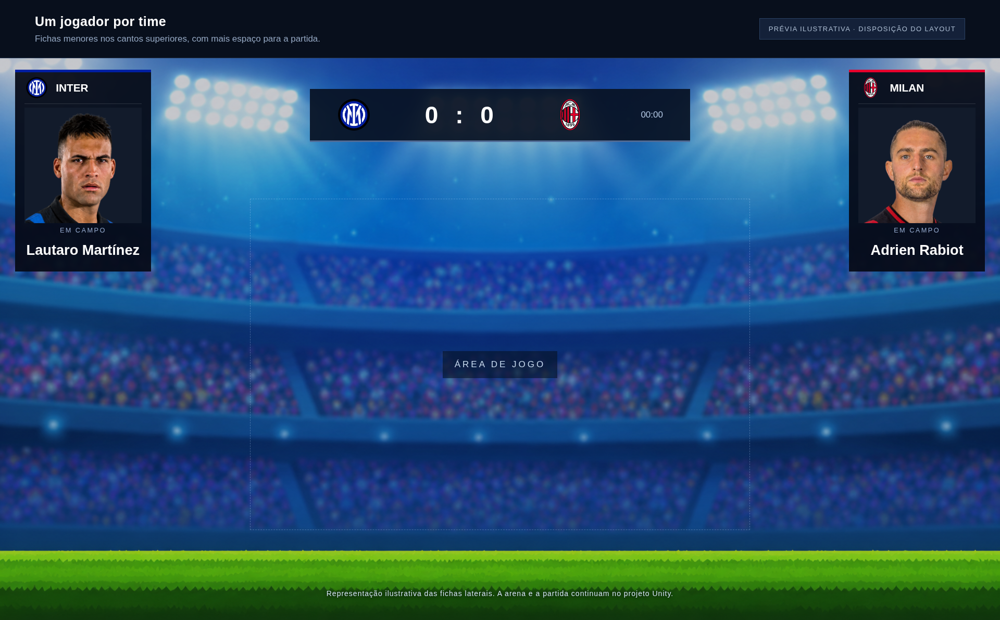

# Futebol Mata-Mata — um jogador por time

Projeto Unity com um jogador representante por equipe na apresentação e na simulação das partidas.

A imagem ilustra a disposição das fichas; não é uma captura do jogo em execução.

## O que mudou

- Cada equipe apresenta uma ficha compacta no seu canto superior, com foto, nome do atleta, escudo, nome e cor do time, deixando mais espaço para os elementos da arena.
- Um único atleta é escolhido por equipe para cada partida. O mesmo atleta representa todos os lançamentos daquele time.
- O elenco completo permanece cadastrado para permitir outras escolhas nas partidas seguintes.
- Os antigos espaços dos outros dois jogadores ficam ocultos automaticamente.
- O mata-mata aceita equipes com pelo menos um jogador cadastrado com nome.

## Baixar e abrir

1. No GitHub, clique em **Code > Download ZIP** e extraia o arquivo.
2. No Unity Hub, selecione **Add > Add project from disk**.
3. Escolha a pasta extraída que contém `Assets`, `Packages` e `ProjectSettings`.
4. Abra o projeto com o **Unity 6000.4.11f1**.
5. Abra uma cena em `Assets/Scenes` e entre no **Play Mode**.

O repositório contém o projeto-fonte. Não inclui uma versão executável do jogo.

## Escolher o representante

Abra a ficha da equipe em `Assets/FichasDeTimes`.

- **Sorteio:** marque `Sortear Titulares Aleatorios`. Um jogador do elenco será escolhido para cada partida.
- **Escolha fixa:** desmarque o sorteio, marque `Usar Selecao Manual` e preencha o primeiro elemento de `Indices Titulares` (`indicesTitulares`). O índice `0` indica o primeiro jogador, `1` o segundo, e assim por diante.
- **Primeiro jogador:** com as duas opções desligadas, o primeiro jogador válido do elenco é utilizado.

O sorteio tem prioridade sobre a seleção manual. Os elementos adicionais do campo antigo de índices são ignorados. As fichas existentes mantêm sua configuração de seleção.

O limite de bolas simultâneas permanece independente da quantidade de jogadores: várias bolas podem representar o mesmo atleta.

## Estrutura

- `Assets`: cenas, scripts, imagens, áudios e fichas das equipes.
- `Packages`: dependências do Unity.
- `ProjectSettings`: configurações do projeto e versão do editor.
- `docs/Previa_layout.png`: prévia ilustrativa.

## Validação

A seleção e o lançador passaram em 231 verificações, incluindo elenco vazio, seleção manual, sorteio e compatibilidade com fichas antigas. Os scripts alterados de seleção e interface também foram compilados com tipos de apoio que representam APIs do Unity.

Essas verificações não substituem a execução no editor. O projeto ainda precisa de conferência visual e de funcionamento no Unity, que não estava instalado no ambiente de análise.
